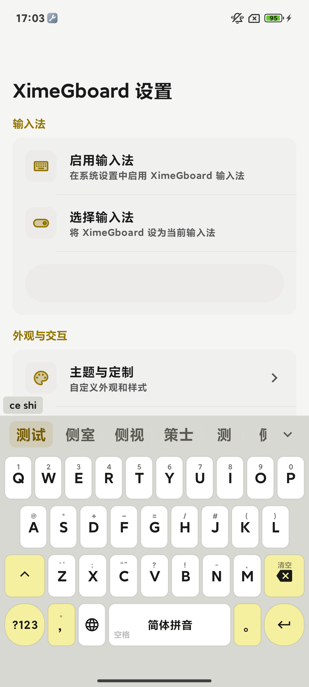
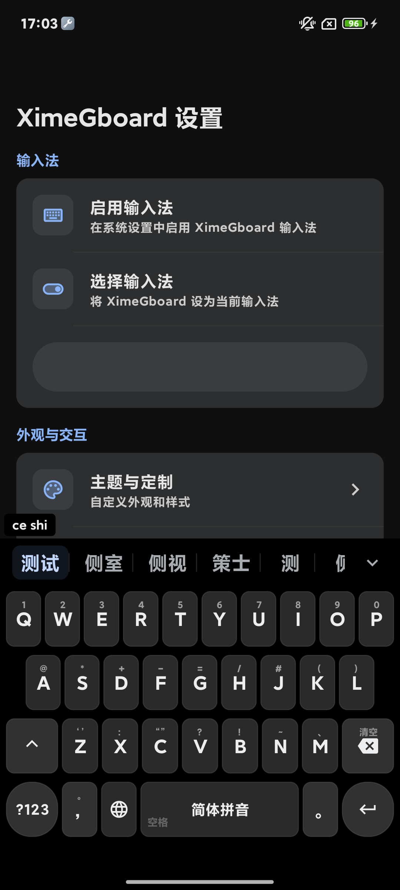
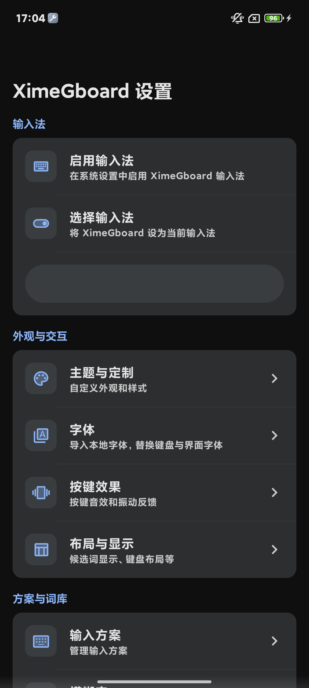
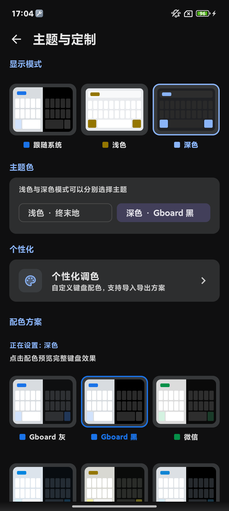

<p align="center">
  
</p>

<h1 align="center">XimeGboard — Wubi / Pinyin Input Method for Android</h1>

<p align="center">
  <a href="README.zh-CN.md">简体中文</a> · <a href="README.zh-TW.md">繁體中文</a>
</p>

<p align="center">
  <sub>Personal fork of <a href="https://github.com/ximeiorg/Xime">Xime</a> by Kingz Cheung and contributors — not the upstream project.</sub>
</p>

[](https://f-droid.org/packages/com.kingzcheung.xime)

<sub>This F-Droid badge points to the **upstream** Xime package. This fork is not published on F-Droid — get the APK from [GitHub Releases](https://github.com/Murchey/Xime-Gboardlike/releases) or [Gitee Releases](https://gitee.com/Murchey/Xime-Gboardlike/releases).</sub>

[Windows Version](https://github.com/ximeiorg/XimeYao) | [Linux Version](https://github.com/ximeiorg/XimeChe) | [Predictive Text Model](https://github.com/ximeiorg/predictive-text) | [Handwriting Model](https://github.com/ximeiorg/ochwpro)

An Android input method built on the [Rime](https://rime.im/) engine, designed for efficient Chinese text input with Wubi (五笔) and Pinyin support.

## About this fork

> **This is a personal fork: [Xime-Gboardlike](https://github.com/Murchey/Xime-Gboardlike), based on the original [Xime](https://github.com/ximeiorg/Xime) by Kingz Cheung and contributors. It is not the upstream project and does not speak for the original author.**

**Design goal.** This fork reworks the input experience around the habits of **Gboard** and **fcitx5-android** users: a quieter, roomier candidate bar; Gboard-inspired color themes; straightforward font and personalization controls; practical clipboard retention options; and a build flow that is friendly to self-installation. The goal is to build a modern, customizable, plugin-capable input method together with the community — not to replace the upstream design.

**Changes in this fork (on top of upstream):**

- Smarter candidate ordering: a built-in "collocation model" reads what you just typed and pulls fitting words to the front — type 就 and 绪 rises up to form 就绪. Works out of the box, no setup.
- Fewer wrong picks among same-code characters: if Shuangpin/Pinyin leaves you staring at rows of homophones, tests show "the first one is right" goes from about 6 in 10 to 9 in 10, so you press digit keys far less; Wubi-style unique codes are unaffected.
- The model is yours: it is a plain local file — import, export, delete, or disable it; no network, no uploads, and the data location stays under your control. You can even train the association model on your own typing data. Technical details in [Grammar model (gram)](#grammar-model-gram).
- Font picker: system default / bundled font / imported fonts, applied globally.
- A curated modern theme set — WeChat, QQ, Telegram, X, GitHub, ChatGPT, Gboard Gray, Gboard Black, and Claude — with light/dark palettes and independent light/dark selection, plus a personalization color panel with JSON import/export.
- Gboard-style candidate bar: wider cells, vertical separators, down-chevron for more candidates; candidate code hints are off by default.
- Clipboard retention from 1 hour up to 90 days, manual history-size input, and migration from the old day-based setting; expired entries are actively purged on a timer.
- Schema settings: a smart deploy/rebuild button and one-tap clearing of compiled schema caches to free up storage.
- A public signing key and `build_apk.bat` for signed, ABI-split personal builds.
- A redesigned application icon: an original SVG mark (blue tile, white keyboard, turquoise X key) in the clean, rounded spirit of Gboard — not a copy of it. Source at [docs/branding/app-icon.svg](docs/branding/app-icon.svg); regenerate Android assets with `python scripts/generate-icons.py`.

**Respect for the original work.** The Rime engine integration, plugin system, architecture, documentation, and the vast majority of the code are the work of **Kingz Cheung and the Xime contributors**. This fork only adds changes on top of their work and is released under the same **GPLv3** license. All credit for the original project remains with its authors. Upstream is the source of truth: if you want the original behavior, official releases, or official support, please use [ximeiorg/Xime](https://github.com/ximeiorg/Xime).

**Why publish the signing key?** A single build cannot satisfy every taste, workflow, or device. Publishing the community keystore (with its password in `app/keystore.properties`) lets anyone fork this project, adjust it, and produce a signed APK that can be installed without waiting for a maintainer. The key is for **personal, sideloaded builds only** — do not use it for app-store distribution or to impersonate the upstream project. Replace it with your own key for public releases.

**Not the right fit?** This repository is an experiment in Gboard/fcitx5-android-style personalization. If its choices do not suit you, using the original Xime project is explicitly encouraged.

---

> This input method bundles all Rime Ice (雾凇拼音) schemas out of the box. The author primarily uses Xiaohe Shuangpin (小鹤双拼) with full Pinyin as a fallback, so resources focus on full Pinyin and Shuangpin. If you are a Wubi user, the upstream project is recommended — or import a better Wubi schema built for RIME.

## Screenshots

Captured on a real device (Android 13) via ADB from this build:

<table align="center">
  <tr>
    <td><br><p align="center">Keyboard (Light)</p></td>
    <td><br><p align="center">Keyboard (Dark)</p></td>
    <td><br><p align="center">Settings</p></td>
    <td><br><p align="center">Theme & Customization</p></td>
  </tr>
</table>

## Features

- **Multiple Input Schemas** — Built-in Wubi 86/98, Pinyin, and mixed schemas; supports custom schemas (Shuangpin, Stroke, etc.) via the schema marketplace or wireless import
- **Rime Engine** — Powered by the mature and reliable Rime input method engine for accurate Chinese input
- **Rich Keyboard Layouts** — QWERTY full keyboard, T9 Pinyin, Stroke 9-key, Handwriting, Numpad (with calculator)
- **Floating Keyboard** — Floating card style with drag support, semi-transparent rounded design
- **Voice-to-Text** — Optional speech recognition via built-in offline models and online ASR plugins (FunAsr, Volc, etc.; online providers require network and credentials)
- **AI Enhancement** — Optional predictive text for faster input
- **Contextual Grammar Model (gram)** — a bundled octagram language model re-ranks candidates against the full context; models are user-managed local files
- **Clean UI** — Material Design 3, light/dark themes with multiple color schemes and independent light/dark selection
- **Keyboard Adjustment** — Adjustable keyboard height and position
- **Toolbar Customization** — Customizable toolbar button layout and functions
- **Haptic Feedback** — Adjustable sound and vibration intensity
- **Swipe Gestures** — Cursor movement, deletion, symbol input via swipe gestures
- **Clipboard Manager** — Clipboard history with quick send, pinning and configurable retention
- **Clipboard Sync** — Bidirectional clipboard sync with remote devices via plugins (WebDAV, ximed, S3, etc.)
- **Optional Candidate Coding Hints** — Display Wubi codes for candidates to aid learning (off by default)
- **Radical Display** — Swipe down on keys to show Wubi radicals for memory aid
- **Physical Keyboard Support** — Floating candidate bar when using hardware/bluetooth keyboards
- **WebDAV Sync** — Backup and restore schemas and settings via WebDAV
- **Plugin Marketplace** — Extensible TypeScript plugins (kaomoji, clipboard sync, online ASR, etc.) via the built-in extension store

## Grammar model (gram)

**Upstream Xime does not include this design.** Its intelligent prediction works at the **application layer**: an ONNX association model plus a self-learned bigram/trigram cache of your own typing (persisted as JSON), fused to re-rank association candidates — a `.gram` file there is only treated as a generic binary in its file manager. This fork adds a complete **Rime engine-layer** grammar model (librime-octagram `*.gram`) pipeline on top of that:

| | Upstream Xime | This fork |
| --- | --- | --- |
| Prediction layer | Application layer (ONNX association + user n-gram cache) | The same, plus a Rime engine-layer octagram grammar model |
| Grammar model | — | Bundled `XimeGboard.gram` (character n-gram, ~26 MB), shipped inside the APK |
| Scope | Association candidates | Candidate ranking of every enabled schema (global activation) |
| Model management | — | Import / export / delete / disable in-app, with file-format validation |
| Custom models | — | Import any compatible `.gram`; full training pipeline for the association model in [`ModelTrainning/`](ModelTrainning/) |

**How it works.** Activation writes `grammar/language` and `translator/contextual_suggestions` into each schema's custom config; the Rime engine then re-ranks candidates against the whole preceding sentence. This acts on the candidate list itself and complements the application-layer association.

**Scoring (for the curious).** Ranking runs through `Octagram::Query(context, word)`: up to 3 trailing context characters + up to 3 leading candidate characters form 2–6 character keys, probed by longest-prefix match against a Darts double-array trie. Each hit scores `ln P(gram|prefix) + 10` with a length-dependent penalty (`collocation_penalty = -12`, `weak = -24`; no hit is always `-12`), and the maximum wins. The training tool emits values in exactly this range (`value = P·e¹⁰`, weak collocations floored out).

**Measured discrimination.** On 26 same-code homophone sets, comparing gram re-ranking against corpus character frequency (a proxy for plain dictionary order):

| Ranking | Correct candidate at #1 | MRR |
| --- | --- | --- |
| gram re-ranking | 24/26 (92%) | 0.96 |
| character frequency (plain-dictionary proxy) | 15/26 (58%) | 0.77 |
| random | ≈19% | — |

(Offline probe measuring ranking power; end-to-end commit accuracy also depends on dictionary recall and your personal frequencies — words you type often already rank first, so gram's gains concentrate on rare words and first-time collocations.)

**Works out of the box.** The model is bundled and enabled by default. It is a plain local file: export, back up, delete, or disable it at will (ranking then falls back to the engine default) — the location of your data stays under your control.

**Train your own.** Import any octagram-compatible `.gram` to replace the bundled one. For the association model, [`ModelTrainning/`](ModelTrainning/) contains the complete pipeline (corpus → training → int8 quantization → importable package) with a step-by-step guide in [`ModelTrainning/modelGuide.md`](ModelTrainning/modelGuide.md).

## Requirements

- Android 9.0 (API 28) or later

## Installation

### From Releases

1. Download the latest APK from [this fork's Releases](https://github.com/Murchey/Xime-Gboardlike/releases) matching your device ABI:

   - **arm64-v8a**: Modern phones (recommended for most users)
   - **armeabi-v7a**: Older 32-bit phones
   - **x86_64**: Emulators
   - **universal**: All architectures (larger file size)

2. Install the application
3. Enable XimeGboard in system input method settings
4. Set XimeGboard as the current input method

### Downloads from mainland China

The APK is also distributed on Gitee, which is faster and more reliable from mainland China:

- Repository: [https://gitee.com/Murchey/Xime-Gboardlike](https://gitee.com/Murchey/Xime-Gboardlike)
- APKs: open the **Releases** page of that repository and download the latest build for your ABI (arm64-v8a / armeabi-v7a / x86_64 / universal), same choices as above.

GitHub and Gitee releases carry the same content — use whichever is easier to reach. If neither is stable for you, build from source below.

### Build from Source

Requirements: JDK 17+, Android SDK/NDK (see `local.properties`), CMake 3.22+, and initialized git submodules.

```bash
# Clone this fork with submodules
git clone --recursive https://github.com/Murchey/Xime-Gboardlike.git

# Or initialize submodules in an existing clone
git submodule update --init --recursive

# Debug build (for development and verification)
./gradlew assembleDebug

# Release build (signed when app/keystore.properties exists)
./gradlew assembleRelease
```

On Windows, run `build_apk.bat` from the repository root. It builds signed release APKs for each ABI and copies them to `dist/`.

> Build intermediates (`app/build/`, `app/.cxx/`) can grow to several GB. They are generated, not source, and can be deleted safely when you are done building.

### Signed personal builds

This fork ships a public community keystore (`app/xime-gboard.jks` + `app/keystore.properties`) so that anyone can produce an installable, consistently signed APK without extra setup. The key is for **personal, sideloaded builds only** — for public distribution, replace the community keystore with your own key.

## Plugins (Optional)

Plugins are TypeScript modules packaged as `.xipk` archives, installable and enabled from the app's Settings > Extension Store. Examples of plugins maintained in this repository:

- **kaomoji**: Kaomoji text emoticons
- **meme-bunny**: Fun bunny sticker pack
- **funasr-asr** / **volc-asr** / **tencent-asr**: Online speech recognition providers
- **webdav-clipboard-sync** / **ximed-clipboard-sync** / **s3-clipboard-sync**: Clipboard sync providers
- **webdav-backup**: WebDAV backup and restore
- **ai-reply** / **ai-write** / **qwen-translate**: AI assistance plugins
- **quick-phrase** / **typing-stats**: Input productivity tools

For the full plugin list, see the [Plugin Center](https://ime.ximei.me/plugin-list.html), or browse and install directly from the app's Settings > Extension Store. Some plugins are hosted remotely only and are not bundled in this repository.

### Plugin development

Plugin sources are TypeScript modules (`plugins/<name>/main.ts` + `manifest.json` + `resources/`) defined with `definePlugin({...})` and compiled by the `xipm` CLI into a single QuickJS-executable `main.js`, then packaged as `.xipk`:

```bash
xipm build          # compile all plugins -> build/plugin-js/
xipm pack           # package all plugins -> build/plugin-release/*.xipk
xipm test           # run plugin tests (QuickJS + mock host, no device needed)
```

See [tools/xime-plugin/README.md](tools/xime-plugin/README.md) for the full CLI reference.

## Documentation

For detailed documentation, visit [https://ime.ximei.me](https://ime.ximei.me).

- [FAQ](https://ime.ximei.me/faq.html)
- [Rime Schemas List](https://ime.ximei.me/rime-list.html)
- [Plugin List](https://ime.ximei.me/plugin-list.html)
- [AI Models List](https://ime.ximei.me/model-list.html)

## Tech Stack

- Kotlin
- Jetpack Compose
- Material Design 3
- Rime (librime)
- JNI (Native C++)

## Contributing

Contributions welcome! Please read [CONTRIBUTING.md](CONTRIBUTING.md) before submitting a PR.

Core rules:
- **File an Issue first** — All changes require a prior discussion via an Issue
- **Minimal changes** — PRs must contain only the minimum changes needed
- **GPG signing** — All commits must be GPG-signed

## Acknowledgments

- [Rime](https://rime.im/) - Input method engine
- [Trime](https://github.com/osfans/trime) - Configuration reference
- [fcitx5-android](https://github.com/fcitx5-android/fcitx5-android) - Keyboard layout reference
- [onnxruntime](https://github.com/microsoft/onnxruntime) - ONNX inference runtime for predictive text and speech recognition models

## License

GPLv3 License

The original Xime project is © Kingz Cheung and contributors; new modifications in this fork are released under the same GPLv3 license. See [LICENSE](LICENSE).

The Xime name, logo and other brand assets are **not** covered by the GPLv3 license.
See [TRADEMARKS.md](TRADEMARKS.md) for details.
