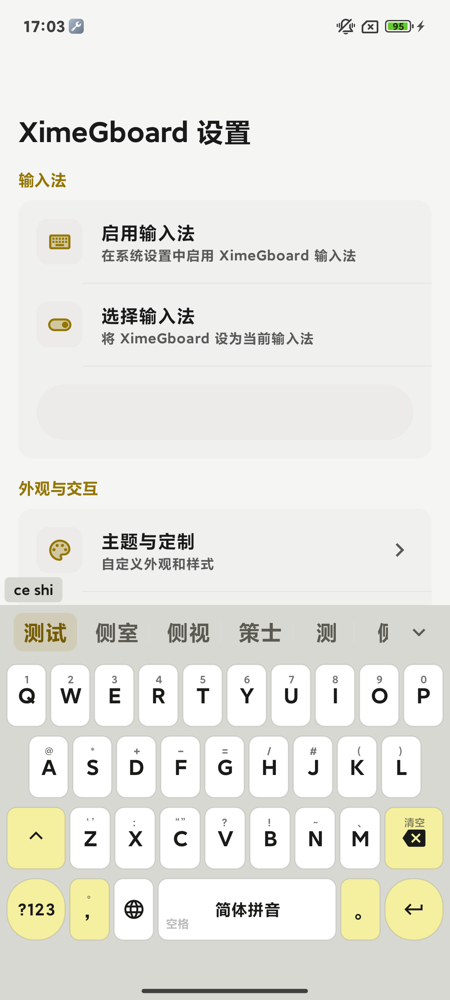
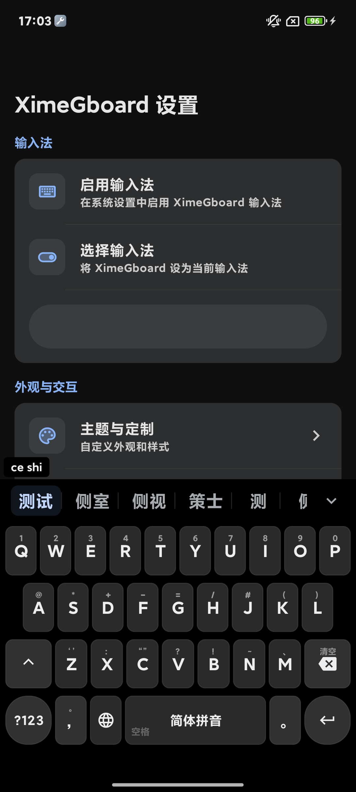
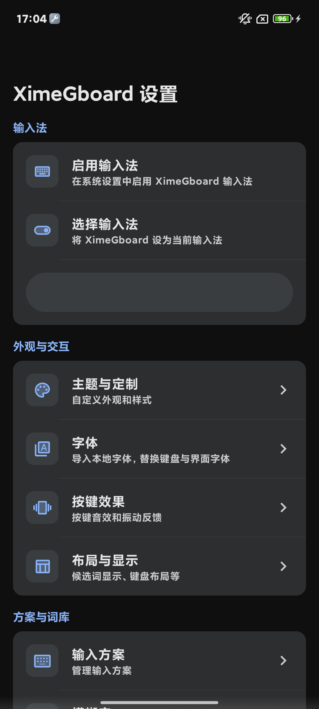
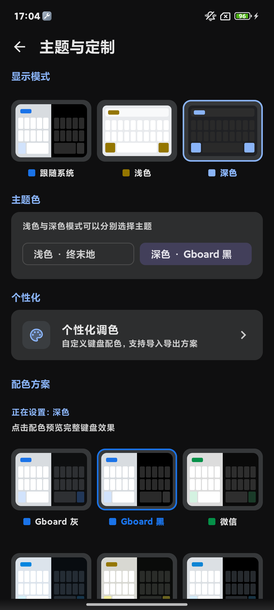

<p align="center">
  
</p>

<h1 align="center">XimeGboard — 五笔/拼音输入法</h1>

<p align="center">
  <a href="README.md">English</a> · <a href="README.zh-TW.md">繁體中文</a>
</p>

<p align="center">
  <sub>基于 <a href="https://github.com/ximeiorg/Xime">Xime</a>（Kingz Cheung 与贡献者）的个人分支 — 不是上游项目。</sub>
</p>

[](https://f-droid.org/packages/com.kingzcheung.xime)

<sub>此 F-Droid 徽章指向**上游** Xime 包。本分支未在 F-Droid 发布，安装包请从 [GitHub Releases](https://github.com/Murchey/Xime-Gboardlike/releases) 或 [Gitee Releases](https://gitee.com/Murchey/Xime-Gboardlike/releases) 下载。</sub>

[Xime 输入法 (Windows 版)](https://github.com/ximeiorg/XimeYao) | [Xime 输入法 (Linux 版)](https://github.com/ximeiorg/XimeChe) | [联想词预测模型](https://github.com/ximeiorg/predictive-text) | [手写输入法模型](https://github.com/ximeiorg/ochwpro)

一款基于 <a href="https://rime.im/">Rime</a> 引擎构建的 Android 五笔/拼音输入法，专注于简洁高效的中文输入体验。

## 关于本分支

> **这是个人分支：[Xime-Gboardlike](https://github.com/Murchey/Xime-Gboardlike)，基于 Kingz Cheung 与贡献者维护的原项目 [Xime](https://github.com/ximeiorg/Xime)。本分支不是上游项目，也不代表原作者。**

**设计理念。** 本分支围绕 **Gboard** 与 **fcitx5-android** 的使用习惯做改造：候选栏更安静、更宽松；采用 Gboard 风格主题色；字体与个性化入口更直接；剪贴板保留策略更实用；同时保持对个人安装友好的构建方式。目标是和社区一起打造一款现代化、可定制、支持插件的优秀输入法，而不是取代上游的设计。

**本分支的修改（在上游基础上）：**

- 候选排序更聪明：内置一个「搭配模型」，会看着前文把更搭的词往前提——打了「就」，「绪」自动提前拼成「就绪」。装上即用，无需任何配置。
- 同音字选得更准：拼音/双拼总在一堆同码字里挑花眼？实测「第 1 个就是对的」从约 6 成提到 9 成，按数字翻候选的次数明显变少；五笔这类编码唯一的输入不受影响。
- 模型你说了算：模型就是个本地文件，可导入/导出/删除/停用，不联网、不上传，数据放哪由你掌控；联想模型还可以用你自己积累的输入训练专属版本。技术细节见 [语法模型（gram）](#语法模型gram)。
- 字体选择：系统默认 / 内置字体 / 已导入字体，一次选择全局生效。
- 精选现代主题：微信、QQ、Telegram、X、GitHub、ChatGPT、Gboard 灰、Gboard 黑、Claude；每套都适配浅色/深色，并支持浅色与深色分别选择；另有支持 JSON 导入导出的个性化调色面板。
- Gboard 风格候选栏：更宽的候选格、竖向分隔线、更多候选下箭头；编码注释默认关闭。
- 剪贴板自动清理支持 1 小时到 90 天，保留条数支持手动输入，并兼容旧版按天设置；过期条目按定时器主动删除。
- 输入方案页提供「部署方案 / 重新编译」智能按钮，可一键清除已编译缓存释放存储空间。
- 提供公共打包密钥与 `build_apk.bat`，便于生成按 ABI 分开的已签名个人安装包。
- 重新设计应用图标：原创 SVG 标识（蓝色圆角底、白色键盘、青色 X 键），借鉴 Gboard 清爽圆润的风格但不照搬其图形。源文件见 [docs/branding/app-icon.svg](docs/branding/app-icon.svg)，可用 `python scripts/generate-icons.py` 重新生成 Android 资源。

**尊重原作者的代码与劳动。** Rime 引擎接入、插件体系、整体架构、文档以及绝大部分代码，均来自 **Kingz Cheung 与 Xime 贡献者**。本分支只在其成果之上做增量修改，并沿用 **GPLv3** 许可证；原项目的全部荣誉归原作者及贡献者所有。上游才是项目的源头：如果你希望使用原始行为、官方发布或官方支持，请使用 [ximeiorg/Xime](https://github.com/ximeiorg/Xime)。

**为什么公开打包密钥？** 单一构建产物不可能完全符合所有人的审美、习惯和设备环境。公开社区 keystore（密码同样放在 `app/keystore.properties`），是为了让任何人都能 fork 本项目、按自己的喜好修改，并直接打出可安装、签名一致的 APK，而不必等待维护者。该密钥**仅用于个人侧载构建**，不要用于应用商店发布，也不要用来冒充上游项目；正式对外发布请替换为你自己的密钥。

**如果不适合你？** 本仓库只是对 Gboard / fcitx5-android 风格个性化的一次尝试。如果你的习惯与本分支不同，**推荐直接使用原仓库项目**。

---

> 本地输入法内置雾凇拼音的所有方案，本人以小鹤双拼为主，全拼为辅，因此资源注重全拼和双拼。如果你是五笔用户，建议使用上游项目，或者导入基于 RIME 打造的更好的五笔方案使用。

## 界面截图

以下截图取自本构建在真机（Android 13）上通过 ADB 实拍：

<table align="center">
  <tr>
    <td><br><p align="center">键盘（亮色）</p></td>
    <td><br><p align="center">键盘（暗色）</p></td>
    <td><br><p align="center">设置主页</p></td>
    <td><br><p align="center">主题与定制</p></td>
  </tr>
</table>

## 功能特点

- **多种输入方案** — 内置雾凇拼音全系方案（含小鹤/自然码/微软等各双拼），另保留五笔86/98；支持自定义方案（笔画等），可通过方案市场下载或无线导入
- **Rime 引擎** — 使用成熟稳定的 Rime 输入法引擎，精准可靠的中文输入体验
- **丰富键盘布局** — QWERTY 全键盘、T9 九宫格拼音、九宫格笔画、手写、数字（含计算器）
- **悬浮键盘** — 悬浮卡片样式，支持拖拽移动、半透明圆角设计
- **语音转文本** — 可选语音识别能力：内置离线模型与在线 ASR 插件（FunAsr、火山等；在线服务需联网并配置密钥）
- **AI 智能增强** — 可选联想词预测，输入更高效
- **上下文语法模型（gram）** — 内置八元语法模型，候选随上文整句重排；模型为用户可控的本地文件
- **简洁界面** — Material Design 3 风格，浅色/深色主题多配色，支持浅色与深色分别选择
- **键盘调节** — 支持键盘高度调整和位置移动
- **工具栏定制** — 可自定义工具栏按钮布局和功能
- **按键反馈** — 可调节音效和振动强度
- **滑动手势** — 光标移动、删除、符号输入等滑动手势操作
- **剪贴板管理** — 剪贴板历史记录，支持快捷发送、置顶与可配置保留策略
- **剪贴板同步** — 通过插件与远端设备双向同步剪贴板（WebDAV、ximed、S3 等）
- **候选词编码提示** — 候选词可显示五笔编码，辅助学习（默认关闭）
- **字根显示** — 下滑按钮显示五笔字根，方便健忘用户
- **实体键盘支持** — 连接物理/蓝牙键盘时显示浮动候选栏
- **WebDAV 同步** — 通过 WebDAV 备份和恢复方案与配置
- **插件市场** — 通过内置扩展商店安装可扩展 TypeScript 插件（颜文字、剪贴板同步、在线 ASR 等）

## 语法模型（gram）

**上游 Xime 没有这套设计。** 上游的智能预测工作在**应用层**：ONNX 联想模型 + 用户输入自学习的二元/三元组缓存（JSON 持久化），融合后对联想词排序——`.gram` 在上游只是文件管理器里的普通二进制文件。本分支在其之上增加了一条完整的 **Rime 引擎层**语法模型（librime-octagram `*.gram`）链路：

| | 上游 Xime | 本分支 |
| --- | --- | --- |
| 预测层次 | 应用层（ONNX 联想 + 用户 n-gram 缓存） | 同上游，另加 Rime 引擎层八元语法模型 |
| 语法模型 | — | 内置 `XimeGboard.gram`（字符 n-gram，约 26MB），随 APK 分发 |
| 生效范围 | 联想候选 | 全部已启用方案的候选排序（一键全局激活） |
| 模型管理 | — | App 内导入 / 导出 / 删除 / 停用，带文件格式校验 |
| 自定义模型 | — | 可导入任意兼容的 `.gram`；联想模型的完整训练流水线在 [`ModelTrainning/`](ModelTrainning/) |

**工作原理。** 激活时向每个方案的自定义配置写入 `grammar/language` 与 `translator/contextual_suggestions`，由 Rime 引擎在取词阶段按上文整句对候选重排。它直接作用于候选列表，与应用层联想互补。

**打分机制（给想深挖的读者）。** 排序由 `Octagram::Query(context, word)` 完成：取上文末尾 ≤3 字 + 候选开头 ≤3 字拼成 2~6 字键，在 Darts 双数组 trie 上做最长前缀命中；每个命中得 `ln P(gram|prefix) + 10`，再按搭配长度施加惩罚（`collocation_penalty = -12`、`weak = -24`，未命中恒为 `-12`），取最大值。训练侧的值域与此严格对齐（`value = P·e¹⁰`，低强度搭配截断为 0 分退化为默认）。

**实测判别力。** 在 26 组同音易混候选集上，对比「gram 重排」与「语料字频序（模拟纯词典默认序）」：

| 排序方式 | 正确候选排第 1 | MRR |
| --- | --- | --- |
| gram 重排 | 24/26（92%） | 0.96 |
| 字频序（纯词典近似） | 15/26（58%） | 0.77 |
| 随机序 | ≈19% | — |

（离线抽测，衡量的是排序判别力；端到端上屏还受词典召回与个人词频影响——常打的词本来就排第 1，gram 的增益集中在低频词与首次输入的搭配上。）

**开箱即用。** 模型随 APK 内置并默认启用，且是纯本地文件：可随时导出、备份、删除或停用（停用后排序恢复引擎默认）——数据存放位置始终由用户掌控。

**自训模型。** 导入任意八元语法兼容的 `.gram` 即可替换内置模型。联想模型方面，[`ModelTrainning/`](ModelTrainning/) 提供完整流水线（语料 → 训练 → int8 量化 → 可导入模型包），分步指南见 [`ModelTrainning/modelGuide.md`](ModelTrainning/modelGuide.md)。

## 系统要求

- Android 9.0 (API 28) 及以上

## 安装

### 从 Release 下载

1. 在 [本分支 Releases](https://github.com/Murchey/Xime-Gboardlike/releases) 页面下载与设备架构匹配的最新 APK：

   - **arm64-v8a**: 适用于大多数现代手机（**绝大部分人的手机都是这个**）
   - **armeabi-v7a**: 适用于旧款32位手机
   - **x86_64**: 适用于模拟器
   - **universal**: 包含所有架构，体积较大

2. 安装应用
3. 在系统设置中启用 XimeGboard 输入法
4. 将 XimeGboard 设为当前输入法

### 国内下载

本分支在 Gitee 同步分发安装包，国内访问更快、更稳定：

- 仓库：[https://gitee.com/Murchey/Xime-Gboardlike](https://gitee.com/Murchey/Xime-Gboardlike)
- 安装包：到该仓库的 **发行版（Releases）** 页面下载与设备架构匹配的最新 APK，选择方式同上（arm64-v8a / armeabi-v7a / x86_64 / universal）。

GitHub 与 Gitee 的 Release 内容一致，任选其一即可；若两边都下载不稳定，也可以[从源码构建](#从源码构建)后自行安装。

### 从源码构建

环境要求：JDK 17+、Android SDK/NDK（见 `local.properties`）、CMake 3.22+，并初始化 git 子模块。

```bash
# 克隆本分支（包含子模块）
git clone --recursive https://github.com/Murchey/Xime-Gboardlike.git

# 或者在已克隆的项目中初始化子模块
git submodule update --init --recursive

# Debug 构建（开发验证用）
./gradlew assembleDebug

# Release 构建（存在 app/keystore.properties 时自动签名）
./gradlew assembleRelease
```

Windows 下在仓库根目录运行 `build_apk.bat`，会生成按 ABI 分开的已签名 release APK，并复制到 `dist/`。

> 构建中间产物（`app/build/`、`app/.cxx/`）可能达到数 GB；它们是生成文件而非源码，打包完成后可以安全删除。

### 个人签名打包

本分支随仓库提供公共社区证书（`app/xime-gboard.jks` + `app/keystore.properties`），无需额外配置即可生成可安装、签名一致的 APK。该密钥**仅用于个人侧载构建**；如需对外正式发布，请替换为你自己的密钥。

## 插件（可选）

插件为 TypeScript 模块打包的 `.xipk` 归档，可在主应用"设置 > 扩展商店"中安装和启用。本仓库维护的部分插件：

- **kaomoji**: 颜文字插件（提供精选颜文字）
- **meme-bunny**: 恶搞兔表情包插件
- **funasr-asr** / **volc-asr** / **tencent-asr**: 在线语音识别服务
- **webdav-clipboard-sync** / **ximed-clipboard-sync** / **s3-clipboard-sync**: 剪贴板同步服务
- **webdav-backup**: WebDAV 备份与恢复
- **ai-reply** / **ai-write** / **qwen-translate**: AI 辅助插件
- **quick-phrase** / **typing-stats**: 输入效率工具

更多插件请查看 [插件中心列表](https://ime.ximei.me/plugin-list.html)，或直接到手机应用的"设置 > 扩展商店"中浏览安装。部分插件仅托管在远程插件中心，不随本仓库附带。

### 插件开发

插件源码为 TypeScript 模块（`plugins/<name>/main.ts` + `manifest.json` + `resources/`），用 `definePlugin({...})` 定义扩展点，由 `xipm` CLI 编译为 QuickJS 可执行的单文件 `main.js`，再打包为 `.xipk`：

```bash
xipm build          # 编译全部插件 -> build/plugin-js/
xipm pack           # 打包全部插件 -> build/plugin-release/*.xipk
xipm test           # 运行插件测试（QuickJS + mock host，无需真机）
```

完整 CLI 用法见 [tools/xime-plugin/README.md](tools/xime-plugin/README.md)。

## 使用文档

详细使用说明请查看 [使用文档](https://ime.ximei.me)。

- [常见问题 FAQ](https://ime.ximei.me/faq.html)
- [Rime 方案列表](https://ime.ximei.me/rime-list.html)
- [插件列表](https://ime.ximei.me/plugin-list.html)
- [AI 模型列表](https://ime.ximei.me/model-list.html)

## 技术栈

- Kotlin
- Jetpack Compose
- Material Design 3
- Rime (librime)
- JNI (Native C++)

## 贡献

欢迎贡献！在提交 PR 之前，请先阅读 [CONTRIBUTING.md](CONTRIBUTING.md) 了解贡献流程。

核心规则：
- **先提 Issue** — 所有改动必须先创建 Issue 讨论
- **最小修改** — PR 只包含所需的最小改动
- **GPG 签名** — 所有 commit 必须 GPG 签名

## 致谢

- [Rime](https://rime.im/) - 中州韵输入法引擎
- [Trime](https://github.com/osfans/trime) - 同文输入法，配置参考
- [fcitx5-android](https://github.com/fcitx5-android/fcitx5-android) - 键盘布局参考
- [onnxruntime](https://github.com/microsoft/onnxruntime) - 联想词预测与语音识别的 ONNX 推理引擎

## 许可证

GPLv3 License

原 Xime 项目 © Kingz Cheung 与贡献者；本分支的新增修改同样以 GPLv3 发布，详见 [LICENSE](LICENSE)。

"Xime" 名称、Logo 及其他品牌资产**不在** GPLv3 开源授权范围内，详见 [TRADEMARKS.md](TRADEMARKS.md)。
